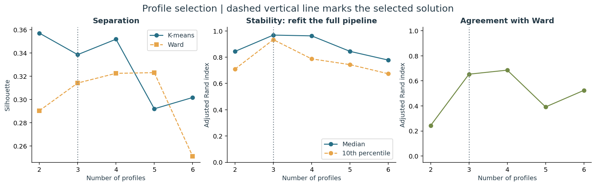

# São Paulo health profiles

**Socioeconomic profiles and inequalities in recorded health resources across 645 municipalities.**

The analysis identifies 3 exploratory socioeconomic profiles across 645 municipalities. Non-SUS physician employment links are more strongly associated with income than SUS links. Demographic adjustment weakens these associations, while basic health unit density shows almost no remaining income association.

## Main results

- Non-SUS physician jobs and mean income: Spearman **0.56**, falling to **0.26** after demographic adjustment. SUS: **0.31 → 0.19**.
- Basic health units per resident: **-0.42 → -0.03**. Facility density alone does not measure service capacity.
- **3 exploratory profiles**, silhouette **0.34**, median full-pipeline refit ARI **0.97**, Ward agreement **0.65**. Profiles overlap and depend on variable and weighting choices.
- Pooled infant mortality: **12.64 vs 10.69** deaths per 1,000 live births in lowest/highest mean-income quartiles; the municipal correlation is near zero.
- Spatial patterns in income and non-SUS resources are stronger than in SUS physician jobs. No local income association survives conservative BY correction at 5%.



## Read the analysis

- [Complete report](reports/report.html): download and open in a browser; all nine figures are embedded.
- [Executed reading notebook](notebooks/analysis.ipynb): tables, explanations and embedded figures.
- [Model selection](reports/tables/cluster_validation.csv), [resource comparisons](reports/tables/profiles.csv), [adjusted associations](reports/tables/associations.csv).
- [Methods and limitations](docs/methodology.md), [data dictionary](docs/data_dictionary.md), [source manifest](data/sources.json).

## Reproduce

Python 3.11 or newer. From the extracted repository folder:

```powershell
python -m venv .venv
.venv\Scripts\Activate.ps1
python -m pip install -r requirements.txt
python run.py verify
python run.py run
python -m unittest discover -s tests -v
```

On macOS/Linux, activate with `source .venv/bin/activate`. Activation can be skipped by calling the virtual environment's Python directly. The analysis needs no internet connection after dependencies are installed: frozen source data are bundled. Tested package versions are pinned in `requirements.txt`; run metadata records actual versions and runtime.

Optional Make targets: `make fetch`, `make run`, `make test`, `make verify`. Make is not required; the Python commands work directly on Windows.

`python run.py fetch` downloads missing sources with frozen-hash verification. `python run.py fetch --refresh` downloads new versions into `data/latest/` for a new audit, preserving this study. A provider revision cannot silently replace reference bytes. All initial CSVs now have official source URLs.

## Methods

1. Validate source keys, units, category totals and denominators; join by seven-digit IBGE code.
2. Build social profiles with log income, literacy and adverse sanitation, standardized with equal municipal weights.
3. Compare K-means/Ward for k=2–6; 80 resamples per k with preprocessing refitted; 10 seeds; leave-one-health-region-out and individual excluded-municipality stability.
4. Compare health indicators against profiles and simple income groups; use partial rank correlations with 400 health-region block resamples.
5. Test global spatial association under two graphs and a targeted local income analysis with multiple-testing correction.
6. Pool infant deaths and births; report count intervals and denominator sensitivity.

PCA visualizes the feature space. Health indicators never define the profiles or select k. The selection heuristic is exploratory, documented and not preregistered. All candidate assignments and a transparent JSON model are included.

## Important interpretation limits

- Professional counts are **employment links**, not unique clinicians or full-time equivalents.
- Resource dictionaries say December 2023 while catalog labels say 2024. The exact year remains uncertain; both population denominators are tested.
- Missing professional/bed records are not zeros. Bed data are retained and audited, but excluded from substantive comparisons.
- UBS counts measure facilities, not capacity. Municipal resources do not measure patient access across borders.
- Social data refer to 2022 and health indicators to around 2023–2024. This is an ecological, descriptive study, not a forecast or causal evaluation.

## Repository structure

| Path | Purpose |
|---|---|
| `src/sp_health/data/` | Acquisition, validation and indicator construction |
| `src/sp_health/analysis/` | Clustering, health comparisons and spatial tests |
| `src/sp_health/reporting/` | Static figures, report and reading notebook |
| `data/raw/` | Unmodified reference snapshots |
| `data/processed/` | Municipality-level analytical dataset |
| `reports/tables/` | Metrics, profiles, uncertainty, audits and model parameters |
| `reports/figures/` | Nine static PNG figures |
| `docs/` | Methods, definitions and provenance |
| `tests/` | Targeted tests of parsing, aggregation, alignment and spatial calculations |

## Data attribution

IBGE/SIDRA (census and boundaries) and Fundação Seade (population, resources, vital statistics and regional codes). See `data/sources.json` and `docs/sources.md` for URLs, snapshot origins and hashes. Original fields and official names remain in Portuguese. Source data retain their providers' terms; no new license is assigned to them.
